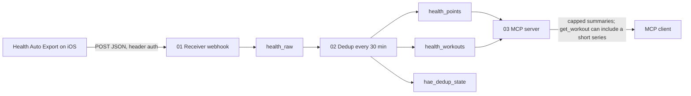

# hae-n8n-mcp

n8n workflow templates that receive Apple Health data from the iOS app [Health Auto Export](https://www.healthyapps.dev/apps/health-auto-export/), deduplicate it into n8n Data Tables, and expose **aggregates only** as an MCP server.

Nothing here stores a sample of anyone's health data, a token, a hostname, or an account id. Paths and credentials in the JSON are placeholders. You create the secrets locally and do not commit them.

1. **HAE 01 - Receiver** accepts `POST` from Health Auto Export, writes the whole JSON body to `health_raw`, and replies `{"ok":true}`. Once a day it deletes raw rows older than 3 days.
2. **HAE 02 - Dedup** runs every 30 minutes. It flattens new raw rows into `health_points` (one row per metric and timestamp) and `health_workouts` (one row per workout). Upserts make a re-send overwrite the same key. Delivery is at-least-once: a failed run can process a raw row again, and the upsert keeps a single row. A watermark in `hae_dedup_state` records how far a successful run got. A lock row in the same table lets only one dedup run work at a time.
3. **HAE 03 - Query MCP server** publishes four read-only tools: `list_metrics`, `get_metric_summary`, `list_workouts`, and `get_workout`. The first three return capped summaries. `get_workout` also returns splits, segments, recovery, and an optional heart-rate series. None of them return the stored raw payload column.

## Why this shape

Other Health Auto Export setups usually add a database and a small service in front of it. These templates stay inside one n8n project:

- Persistence is n8n Data Tables. There is no Postgres, SQLite, or extra process to run.
- Dedup is idempotent. Points are keyed by `metric|timestamp` (UTC). Workouts are keyed by the Health Auto Export workout id. Sending the same export again updates those rows.
- The watermark, plus a 2-minute settle delay, skips raw rows a finished run has already passed. A one-item loop saves the watermark only after that run's point and workout upserts return. If an upsert fails, the loop stops and the next run retries. The watermark is re-read before it is saved and only ever moves forward.
- Runs do not overlap unless one outlasts the 120-minute lock. A run takes the `health_raw_dedup_lock` row in `hae_dedup_state` (its execution id and an expiry 120 minutes out) and releases it as the last step. A tick that finds a live lock owned by another execution stops before it reads `health_raw` or writes anything. A run that fails keeps the lock until it expires, so dedup pauses for at most 120 minutes. Details and limits are in [docs/setup-n8n.md](docs/setup-n8n.md#dedup-lock).
- The calendar is the workflow timezone (**Settings → Timezone** on each workflow). The template ships as `Asia/Taipei`. Change all three workflows together. `received_at` itself is stored in UTC so the watermark still sorts correctly if that zone observes daylight-saving time.
- The MCP tools cap the window (92 days for daily buckets, 366 days for week or month, 50 workouts, 200 heart-rate points). An assistant gets a summary, not a dump of every sample.

## Requirements

n8n **2.43.0 or newer** (2.43.0 was published on 2026-10-06). That floor comes from the `typeVersion` values in the JSON, compared with the n8n release tags, not from an import test.

| Node in the JSON | typeVersion | Present from |
| --- | --- | --- |
| Execute Workflow Trigger (`Tool Input`) | 1.3 | n8n 2.43.0 |
| Webhook | 2.2 | n8n 2.42.0 |
| MCP Server Trigger | 2.1 | n8n 2.36.0 |
| Schedule Trigger (daily cleanup) | 1.4 | n8n 2.36.0 |
| Schedule Trigger (every 30 minutes) | 1.2 | earlier than 2.36 |
| Data table | 1.1 | earlier than 2.42 (Data Tables themselves need at least 1.113.1) |
| Call n8n Workflow Tool | 2.2 | well before 2.43 |
| Switch | 3.2 | earlier than 2.43 |
| If | 2.2 | assumed earlier than 2.43, not checked against tags |
| Wait | 1.1 | assumed earlier than 2.43, not checked against tags |
| Code | 2 | earlier than 2.43 |

2.43.0 is the first release in that check that contains every pinned version. The binding one is Execute Workflow Trigger 1.3. Older n8n will refuse that node on import.

You also need:

- [Health Auto Export](https://www.healthyapps.dev/apps/health-auto-export/) on an iPhone, sending a REST API automation to the receiver webhook ([docs/setup-hae.md](docs/setup-hae.md)).
- Data Tables enabled (they are on by default in current n8n).
- The MCP Server Trigger node (`@n8n/n8n-nodes-langchain.mcpTrigger`).
- Permission to create credentials and data tables in one project. The workflows and the four tables must live in that same project.

A re-test of commit `82c144d` on **n8n 2.46.4** passed the reply-after-insert path, the one-record loop with the watermark last, an idempotent dedup rerun, cleanup using the earlier of now−3 days and the watermark (including no delete when the watermark is missing or not UTC), all four tool cases including a null recovery value at 120 seconds, empty `source` not counted, a Monday week label, and no `timezone_warning` under `Asia/Taipei`. That test did **not** publish workflow 03 or call it from an MCP client, so `{{ $workflow.id }}` is still unverified.

The same run showed a POST with no body was stored (`kind` `unknown`, `body` null) and still got 200. The current files reject that with 400 and do not insert, and dedup advances the watermark past rows it skips. Those two edits have not been imported again. Neither has the dedup lock or the forward-only watermark (see the changelog). CI still only parses JSON, checks node wiring, and syntax-checks the Code nodes.

## Quick start

1. Create the four data tables in [docs/data-tables.md](docs/data-tables.md). Use those names and column types.
   Upgrading an earlier install? Add the string columns `lock_owner` and `lock_until` to `hae_dedup_state` before you import the new workflow 02. See [docs/setup-n8n.md](docs/setup-n8n.md#upgrade-add-the-dedup-lock-columns).
2. Create two credentials, each with a long random secret (`openssl rand -hex 32` is enough) and a name you will recognize. Do not put the secret in git.
   - Header Auth named `HAE Webhook Header Auth`, header such as `X-HAE-Token`.
   - Bearer Auth named `HAE MCP Bearer`.
3. Import [workflows/01-receiver.json](workflows/01-receiver.json), then [workflows/02-dedup.json](workflows/02-dedup.json), then [workflows/03-query-mcp.json](workflows/03-query-mcp.json).
4. After import, on **every** workflow, confirm the checklist in [docs/setup-n8n.md](docs/setup-n8n.md). Some import paths drop settings, and n8n can attach an existing credential of the same type:
   - **Settings → Timezone** is the zone you want (the file says `Asia/Taipei`). **Execution order** is **v1**.
   - Each Data Table node has the table picked by hand. The files ship **By ID** placeholders, not names.
   - `HAE Webhook` uses `HAE Webhook Header Auth`, and `HAE Health MCP Server` uses `HAE MCP Bearer`.
   - Successful production executions, manual executions, and error executions are not saved.
5. Replace the two `CHANGE-ME` paths and publish in the order in [docs/setup-n8n.md](docs/setup-n8n.md).
6. Point Health Auto Export at the production webhook. See [docs/setup-hae.md](docs/setup-hae.md).
7. Put n8n on HTTPS with a path allowlist and a body size that fits a batched export. See [docs/reverse-proxy.md](docs/reverse-proxy.md).
8. Connect an MCP client with the bearer token supplied from an environment variable. See [docs/mcp-client.md](docs/mcp-client.md). Publishing workflow 03 and calling it from that client is still an unverified step.

## Configuration

These values are fixed in the workflow JSON. Change them in the node the sticky note names, then keep the docs in step. They are not workflow variables.

| Constant | Value | Where |
| --- | --- | --- |
| Raw retention | 3 days | 01, `Delete rows older than 3 days` |
| Raw cleanup clock | 03:30 in the workflow timezone | 01, `Daily cleanup 03:30` |
| Dedup interval | every 30 minutes | 02, `Every 30 minutes` |
| Settle delay | 2 minutes | 02, upper bound on `Read new health_raw rows` |
| Watermark row | `health_raw_watermark` | 02, read filter and Code node |
| Watermark fallback | `1970-01-01T00:00:00.000Z` | 02, when no watermark row exists |
| Lock row | `health_raw_dedup_lock` | 02, lock nodes, `Release lock`, and the Code node's unlock item |
| Lock expiry | 120 minutes | 02, `LOCK_MINUTES` in `Check lock is free` |
| Lock settle pause | 3 seconds | 02, `Settle 3 seconds` |
| Daily metric window | 92 days | 03, `Aggregate get_metric_summary` |
| Week, month, and workout window | 366 days | 03, summary and `Aggregate list_workouts` |
| Workout list cap | 50, newest first | 03, `Aggregate list_workouts` |
| Heart-rate series cap | 200 points | 03, `Aggregate get_workout` |
| Metric name | `^[A-Za-z0-9_]{1,64}$` | 03, `Aggregate get_metric_summary` |
| Workout id | `^[A-Za-z0-9-]{8,64}$` | 03, `Aggregate get_workout` |

Also fixed in the dedup Code node, and left as they were:

- Point upsert key is `metric` + `|` + UTC timestamp. `source` is stored beside the key and does not split the row.
- Quantity is `qty`, then `Avg` (used for heart rate), then `totalSleep`, then `asleep`.
- Workout duration in the export is seconds. Minutes are `round(seconds / 60)` to one decimal (`/ 6 / 10` in the code).
- Energy: kilojoules are divided by `4.184` to kcal. Anything else is treated as kcal.
- Distance: metres `/ 1000`, miles `* 1.609344`, otherwise already kilometres.
- Health Auto Export sample times are parsed as `yyyy-MM-dd HH:mm:ss ZZZ`, then as ISO.
- `updated_at` on points, workouts, and the watermark is a **local** timestamp in the workflow timezone. It is not the watermark. Sorting it as text can still break across a daylight-saving change.
- Week buckets use Luxon's `startOf('week')` without `useLocaleWeeks`. On the n8n 2.46.4 test that label was the Monday of the ISO week.
- `list_metrics` counts only non-empty `source` values.
- Heart-rate recovery `after_60s_bpm` and `after_120s_bpm` are the first sample at or after that offset. They are null when the series ends earlier.
- `list_metrics` reads the whole `health_points` table. `get_metric_summary` reads every row of that metric, then applies the date cap. The caps limit the answer, not the read.

A raw row whose `received_at` is not a parseable timestamp does not move the watermark. Workflow 01 always writes the UTC stamp, so this only matters if a row was edited by hand. Those rows are read again every 30 minutes until you fix or delete them. Cleanup will not delete them while the watermark is still behind them.

`received_at` on `health_raw` is not in that "leave it" list. It used to be a local ISO string with a numeric offset, compared as text. Those strings do not stay in time order when the offset changes. `2000-01-01T02:30:00.000+02:00` is 00:30 UTC and `2000-01-01T02:15:00.000+01:00` is 01:15 UTC, but the `02:30` text sorts second. New rows and the watermark use UTC `yyyy-MM-dd'T'HH:mm:ss.SSS'Z'`, which is fixed width, so text order matches time. If you already ran the old form, read the upgrade steps in [docs/setup-n8n.md](docs/setup-n8n.md) before you publish the new dedup workflow. Mixing the two forms in one column stalls the watermark.

## Security

- The webhook path and the MCP path are secrets. `hae-ingest-CHANGE-ME` and `hae-mcp-CHANGE-ME` are markers, not values to deploy. Replace both with long random strings.
- Header Auth on the webhook and Bearer Auth on MCP are mandatory in these templates. Generate the tokens yourself. The JSON stores the credential **name** only. After import, open both triggers and confirm those credentials are the ones selected. n8n can attach another existing Header Auth or Bearer credential of the same type.
- Publish n8n through a reverse proxy or Cloudflare Tunnel that allows only `/webhook/<your-ingest-path>` and `/mcp/<your-mcp-path>`. Do not expose the editor, `/rest`, or the rest of the host. Details and body-size limits are in [docs/reverse-proxy.md](docs/reverse-proxy.md).
- Anyone who has the bearer token can ask the four tools. The answers go to whichever LLM provider that MCP client uses. Treat the token like a password. Prefer passing it from an environment variable into `mcp-remote` rather than pasting it into a committed config.
- `health_raw.body` and `health_workouts.body` hold the full export. Workout `body` can include a GPS route when the phone exported one. The MCP tools do not return those columns. `get_workout` still returns per-workout splits, segments, recovery, and up to 200 heart-rate points. Anyone who can open the n8n project can read the tables.
- Successful production executions, manual executions, and error executions are not saved (`saveDataSuccessExecution`, `saveManualExecutions`, and `saveDataErrorExecution` are all off). A failed run still returns an error to the caller, but n8n does not keep the input or output. To debug one failure, turn **Save failed production executions** on for that workflow, reproduce the run, read it, then set it back to not save and delete the execution you just stored. It contains the health payload. n8n 2.46 still prunes executions by default (`EXECUTIONS_DATA_PRUNE=true`, max age 336 hours, max count 10000) if you leave any saving on. Raw table rows are deleted only after dedup has passed them and they are older than 3 days. Flattened points and workouts are kept until you delete them.
- Missing the timezone step leaves the instance default. These files use `Asia/Taipei`. A UTC zone adds `timezone_warning` on tool results and on the dedup watermark note. Changing the zone later does not rewrite `date_local` already stored.
- ECG and any other Health Auto Export type that is not under `data.metrics` or `data.workouts` is not turned into queryable rows. The raw post still sits in `health_raw` until cleanup, and cleanup deletes a row only after the watermark has passed it and it is older than 3 days. Do not point this webhook at a shared inbox.

## Layout

| Path | Contents |
| --- | --- |
| [workflows/](workflows/) | The three importable workflow files |
| [docs/data-tables.md](docs/data-tables.md) | Column definitions |
| [docs/setup-n8n.md](docs/setup-n8n.md) | Import, credentials, timezone, upgrade |
| [docs/setup-hae.md](docs/setup-hae.md) | Health Auto Export automations |
| [docs/mcp-client.md](docs/mcp-client.md) | Claude Desktop and other MCP clients |
| [docs/reverse-proxy.md](docs/reverse-proxy.md) | nginx and Cloudflare Tunnel allowlists |
| [scripts/check_repo.py](scripts/check_repo.py) | JSON, structure, Code syntax, secret scan |
| [.github/workflows/check.yml](.github/workflows/check.yml) | Runs that script |

## License

[MIT](LICENSE), copyright delbinwen.
